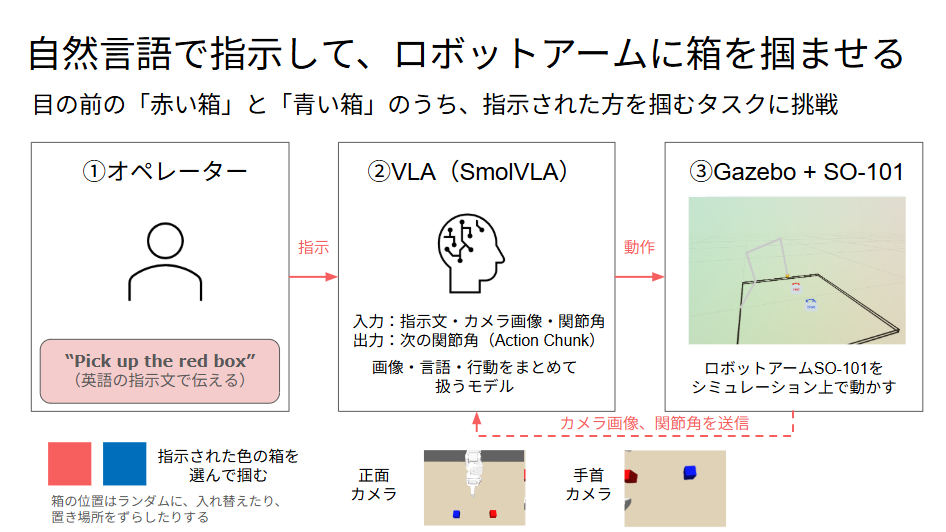
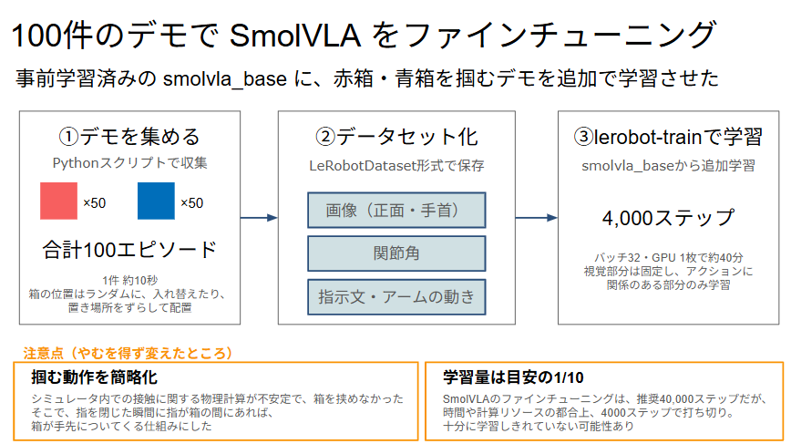
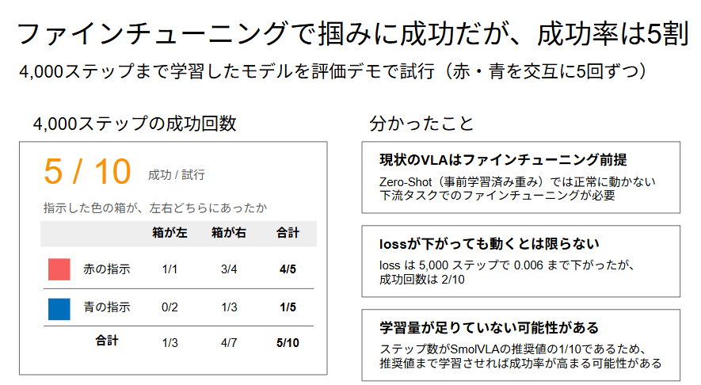

# practice-vla-robot-arm

外部の講座「Physical AI 応用編1 基礎理論と実践」で学んだことを生かして、ロボットアームをVLAで操作する







Gazebo 上の SO-101 アームを SmolVLA（LeRobot）で言語指示により動かす。設計は [docs/設計.md](docs/設計.md)。


- ゴール：赤箱・青箱の前で、**言語指示を変えるだけで掴む箱が切り替わる**ことを VLA（SmolVLA）で確認する
- 進め方：学習データ（エピソード）をプログラムで収集 → ファインチューニング → 評価（ファインチューニング前の `smolvla_base` とも比べる）
- 可視化：デモデータセットも推論時の振る舞いも rerun で確認できる

構成・フローの図は [docs/図/](docs/図/README.md)（システム構成・ライブラリ依存・デモ収集・ファインチューニング・推論実行）。

## 起動（WSL2 上で実行）

```bash
docker compose up -d --build        # GPU マシン: docker compose -f compose.yaml -f compose.gpu.yaml up -d --build
docker compose exec sim bash        # Gazebo / ros2_control 側
docker compose exec policy bash     # 推論側（/opt/venv の Python 3.10 に lerobot 0.4.0 / rerun 0.26.2）
bash scripts/check_env.sh            # 動作確認（Gazebo の版・lerobot import・コンテナ間通信）
```

リポジトリ直下がコンテナ内の `/ws` にマウントされる。

GPU マシンでは、sim の描画も GPU になり、sim を実時間（RTF 1）で動かす（CPU では RTF 約 0.16）。CPU / GPU の設定値の違いは [docs/sim速度設定.md](docs/sim速度設定.md) の 0 章。

## シミュレーションの起動

```bash
docker compose exec sim bash -lc 'cd /ws && source /opt/ros/humble/setup.bash && colcon build --symlink-install'   # 初回と、ソース変更後
bash scripts/sim_restart.sh              # ヘッドレスで起動（約1分）。GUI を出すなら: bash scripts/sim_restart.sh gui:=true
bash scripts/check_sim.sh                 # 動作確認
bash scripts/cmd.sh 0 0 0 0 0 0.8        # 6関節の目標角 [rad] を送る
docker compose exec sim bash -lc 'source /opt/ros/humble/setup.bash; ros2 service call /scene/reset std_srvs/srv/Trigger'   # 箱を再配置
```

## SmolVLA で動かす（Phase A）

sim を起動した状態で、policy コンテナの推論ノードを1エピソード（既定で推論 6 回）動かす。CPU では推論1回に約 30 秒かかり、その間は sim を一時停止する。

```bash
bash scripts/run_policy.sh                                              # config/policy_base.yaml（"pick up the red box"）
bash scripts/run_policy.sh config/policy_base.yaml --instruction "pick up the blue box" --max-chunks 3
bash scripts/run_policy.sh config/policy_base_gpu.yaml                                  # GPU マシン（device: cuda。推論1回 約 0.4 秒）
docker compose exec sim bash -lc 'source /opt/ros/humble/setup.bash; ros2 topic pub --once /vla/instruction std_msgs/msg/String "{data: pick up the blue box}"'   # 実行中に指示を切り替える
```

カメラ・関節・指令・モデルへの入力・予測・推論時間が `outputs/rrd/<日時>_<指示>.rrd` に残る（開き方は次の節）。
ファインチューニング 前（smolvla_base）の挙動は [docs/rrd/phase_a_cpu_red.rrd](docs/rrd/phase_a_cpu_red.rrd)・[docs/rrd/phase_a_cpu_blue.rrd](docs/rrd/phase_a_cpu_blue.rrd) に保管している（赤・青の指示で各1エピソード。どちらも掴めていない）。

## デモを収集する

sim を起動した状態で、ikpy の経由点で箱を掴むデモを自動で集め、LeRobotDataset（fps 10・動画保存）に書き込む。成功し、かつ 10Hz にそろえるときの重複フレームが 10 以下（`--max-duplicates`）のエピソードだけ保存し、既にあれば追記する。不採用のエピソードは捨てずに `<root>_rejected`（同じ形式）に残す。赤・青は交互、左右はランダム。

```bash
docker compose exec sim bash -lc 'cd /ws && source /opt/ros/humble/setup.bash && source install/setup.bash && xacro src/so101_description/urdf/so101.urdf.xacro > outputs/so101.urdf'   # 初回（IK 用）
bash scripts/collect_demo.sh --episodes 2 --root outputs/datasets/smoke      # 1 エピソード約 80〜90 秒（壁時計）
bash scripts/smoke_train.sh outputs/datasets/smoke                           # ファインチューニング のスモークテスト（CPU で 3 ステップ。約 15 分）
```

収集したデータは .rrd に変換して rerun で目視確認できる（学習に使われる画像・state・action と、state から再計算した 3D の腕。箱の位置は出ない）。

```bash
docker compose exec -T policy bash -lc 'cd /ws && source /opt/ros/humble/setup.bash && python scripts/dataset_to_rrd.py --root outputs/datasets/smoke --episodes 0 1'   # --all で全エピソード
```

出力は `outputs/rrd/dataset/episode_<番号>_<指示>.rrd`。開き方は次の節と同じ。

データセットの形式（エピソードを連結して保存する仕組み）、特定のエピソードだけの変換、不採用データの扱いは [docs/データセット.md](docs/データセット.md)。

## 挙動を rerun で見る

カメラ2台・関節角・指令・箱の位置・scene_manager のログを `outputs/rrd/<日時>_<名前>.rrd` に記録する（日時はコンテナの時刻＝UTC）。アームを動かすスクリプトと並行して動かす。


上段に3D・正面カメラ・手首カメラ、中段に関節角と指令・予測の波形、箱の高さ（z）とログが並ぶ。**下のタイムラインのシークバーを動かすと、動画を見る感覚で、後から振る舞いを確認できる**（再生・一時停止・コマ送りもできる）。赤箱・青箱の位置や持ち上げの成否、モデルに渡した画像と予測した行動も同じ時間軸で見られる。

```bash
docker compose exec sim bash -lc 'cd /ws && source /opt/ros/humble/setup.bash && source install/setup.bash && xacro src/so101_description/urdf/so101.urdf.xacro > outputs/so101.urdf'   # 初回（3D 表示用）
docker compose exec -d policy bash -lc 'cd /ws && source /opt/ros/humble/setup.bash && python scripts/rrd_record.py grasp_red --duration 35'
docker compose exec policy bash -lc 'cd /ws && source /opt/ros/humble/setup.bash && python scripts/grasp_test.py red'
```

Viewer は SDK と同じ 0.26.2 を使う（.rrd は 0.26.2 で記録しているので、他の版では開けないことがある）。画像・3D の骨格・グラフ・ログ・画面レイアウトはすべて .rrd に入っているので、ファイル1つで見られる。次のどちらかで開く。

```bash
# (1) WSL 上のネイティブ Viewer（WSLg で表示）。XDG_RUNTIME_DIR を WSLg のものにしないと「Could not find wayland compositor」になる
XDG_RUNTIME_DIR=/mnt/wslg/runtime-dir uvx --from rerun-sdk==0.26.2 rerun outputs/rrd/<ファイル名>.rrd
# (2) policy コンテナの rerun で Web Viewer を立て、Windows のブラウザで http://localhost:9090 を開く（インストール不要）
docker compose exec policy bash -lc 'cd /ws && rerun --serve-web --web-viewer-port 9090 outputs/rrd/<ファイル名>.rrd'
```

SO-101 のモデルは [TheRobotStudio/SO-ARM100](https://github.com/TheRobotStudio/SO-ARM100)（Apache-2.0）から取り込んでいる（[出典](src/so101_description/NOTICE.md)）。
