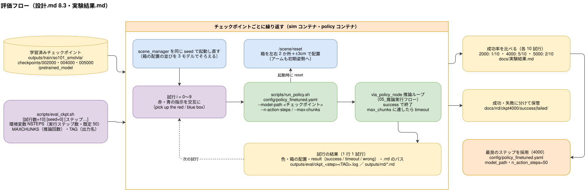

# 実験結果

fine-tune 後のモデルを sim で評価した結果の記録。学習の設定は [学習設定.md](学習設定.md)。

## 0. 評価の流れ

学習（5000 ステップ）の流れは [04_ファインチューニングフロー](図/04_ファインチューニングフロー.svg)、推論の制御ループは [05_推論実行フロー](図/05_推論実行フロー.svg) を参照。

## 1. チェックポイント比較（2026-10-24）

### 目的
学習ログには学習データの loss しかなく、どのステップ数が良いかを判断できない。そこで、保存済みのチェックポイントを同じ条件で sim に走らせて成功率を比べた（限られた学習時間の都合で、少ないステップ数で回した中での比較）。

### 条件
- モデル：`smolvla_base` を、**100 エピソード（合計 10,398 フレーム。1 エピソードは約 100 フレーム＝約 10 秒）**のデモで fine-tune。バッチ 32・5000 ステップ・学習率スケジュールは 5000 ステップで減衰（最終 loss 0.006、約 15 epoch）。2000 ステップごとに保存。
- 学習時間：**5000 ステップで約 53 分**（NVIDIA GPU。ログの開始 06:52:23・終了 07:45:21 UTC。1 ステップ約 0.6 秒）。
- 評価：各チェックポイントを 10 試行（赤・青の指示を交互に各 5）。1 試行は最大 4 チャンク（約 20 秒）で、`success` になれば終了。
- 推論の設定：`config/policy_finetuned.yaml`（制御周期 10Hz・`max_step` 0.15・チャンクの 50 ステップをすべて実行）。
- 箱の配置：各チェックポイントの前に `scene_manager` を同じ seed（0）で起動し直し、箱の配置（左右・ずれ）の並びを 3 モデルで同じにした。
- 実行：`bash scripts/eval_ckpt.sh 10 0`。試行ごとの結果は `outputs/eval/ckpt_<ステップ>.log`（git 管理外）。

### 結果

成功率（success になった試行 / 試行数）：

| チェックポイント | 赤の指示 | 青の指示 | 合計 |
|---|---|---|---|
| 2000 | 1/5 | 0/5 | 1/10（10%） |
| 4000 | 4/5 | 1/5 | **5/10（50%）** |
| 5000 | 1/5 | 1/5 | 2/10（20%） |

2000 の青の 1 試行は `wrong`（指示と別の色の箱を持ち上げた）。残りの失敗はすべて timeout。

指示した色の箱が左右どちらにあったか別の成功数（成功 / 試行）：

| チェックポイント | 赤・箱が左 | 赤・箱が右 | 青・箱が左 | 青・箱が右 |
|---|---|---|---|---|
| 2000 | 0/1 | 1/4 | 0/2 | 0/3 |
| 4000 | 1/1 | 3/4 | 0/2 | 1/3 |
| 5000 | 1/1 | 0/4 | 0/2 | 1/3 |

### 分かったこと
- 今回は限られた学習時間の都合で少ないステップ数（最大 5000）で回したところ、**4000 ステップが最も成功率が高かった**（5/10）。2000 は 1/10、5000 は 2/10 だった。ただし**各 10 試行・差が 3 件程度**なので、順位は決定的ではない。
- 学習が足りていない可能性が高い。SmolVLA の fine-tune は、バッチ 64・20000 ステップ（バッチ 32 なら 40000 ステップ。見るサンプル数は同じ約 128 万）が目安とされている。今回は 5000 ステップ×バッチ 32＝約 16 万サンプルで、目安の約 1/8。**本来はもっと学習時間を確保する必要がある。**5000 の成績が 4000 より下がったことも、過学習というより、評価のばらつきの範囲と考えるのが妥当（過学習かどうかは、この学習量では判断できない）。
- 最初に確認した 5000 の赤・青各 1 試行は、どちらも掴めなかった（timeout）。たまたま悪い試行だった。5000 でも成功することはある（2/10）。
- 青の成功率が低い（4000 でも 1/5）。
- 左右別の集計は試行数が 1〜4 と少なく、色や位置による傾向は判断できない。
- 失敗の様子（5000 の青、1 試行）：指先は箱の高さ（z 約 0.6cm）まで下りたが、箱の中心から横に約 2cm ずれていて掴めず、箱は約 1cm しか動かなかった。その後は閉じた姿勢のまま止まる。

### 制約
- 試行数が少ない（各 10）。同じ seed の並びなので、モデル間の比較は公平だが、成功率の誤差は大きい。
- 評価の配置は、収集（seed 100）とは別の seed だが、同じ生成方法（左右 2 か所＋±3cm のずれ）。

## 2. 実行するステップ数（`n_action_steps`）の比較

### 目的
`n_action_steps`（1 回の推論で出る 50 ステップのうち、実行する先頭のステップ数）を減らし、こまめに画像を見て推論し直す方が掴めるかを確かめる。1 チャンクを最後まで実行すると、flow matchの仕組みで連続したアクションを生成するときのアクション間の誤差が蓄積する懸念があるため。

### 条件
- モデル：4000 ステップのチェックポイント（1 章で最良）。
- 評価：1 章と同じ seed（0）・同じ箱の配置の並びで、赤・青を交互に 10 試行。
- 1 試行の長さを sim 時間で約 20 秒にそろえた：実行 50 ステップ→推論 4 回、25→8 回、10→20 回。
- 実行：`NSTEPS=<n> MAXCHUNKS=<回数> TAG=_n<n> bash scripts/eval_ckpt.sh 10 0 004000`。結果は `outputs/eval/ckpt_004000_n<n>.log`。

### 結果

| 実行ステップ数 | 赤の指示 | 青の指示 | 合計 |
|---|---|---|---|
| 50（1 章と同じ） | 4/5 | 1/5 | **5/10** |
| 25 | 3/5 | 2/5 | **5/10** |
| 10 | 1/5 | 1/5 | 2/10 |

試行ごと（`o`＝success、`x`＝timeout。番号は 1 章のログと同じ配置）：

| 実行ステップ数 | 0 | 1 | 2 | 3 | 4 | 5 | 6 | 7 | 8 | 9 |
|---|---|---|---|---|---|---|---|---|---|---|
| 50 | o | o | o | x | x | x | o | x | o | x |
| 25 | o | x | o | o | x | o | o | x | x | x |
| 10 | x | o | o | x | x | x | x | x | x | x |

### 分かったこと
- 25 は 50 と同じ 5/10 で、改善は見られなかった。10 は 2/10 とむしろ悪化した。**こまめに推論し直しても、掴める割合は上がらなかった。**
- 25 と 50 で成功した試行は一致しない（50 のみ成功：試行 1・8、25 のみ成功：試行 3・5）。1 試行ごとのばらつきが大きく、10 試行では 5/10 同士の差は誤差の範囲。
- 10 が悪いのは、推論 1 回に約 0.5 秒かかる間は指令が出ず、動きが途切れること、短いチャンクだと「いま全体のどの段階か」が分かりにくくなることが考えられる（未確認）。
- 掴めない原因は、チャンクの長さによる誤差の蓄積だけではなさそう。箱の位置に合わせた細かい姿勢（1 章の「横に約 2cm ずれる」）を学習できていない可能性が残る。

### 制約
- 試行数が各 10 と少ない。n=25 の 1 回目は、sim の `/scene/reset` が応答せず結果が取れなかったため、scene_manager を起動し直してやり直した結果（やり直し前の記録は使っていない）。
