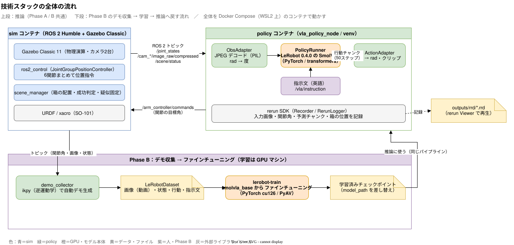

# 技術スタック解説（振り返り用）

この課題で使った技術を「何のためのものか」「このプロジェクトのどこで使ったか」で整理した振り返りメモ。

## 1. 全体の流れと各技術の位置づけ

（図の元データ：[図/07_技術スタックの流れ.drawio](図/07_技術スタックの流れ.drawio)。draw.io で開いて編集する）

## 2. 一覧表

| 分類 | 技術 | 一言でいうと | このプロジェクトでの使いどころ |
| --- | --- | --- | --- |
| 実行環境 | Docker Compose / WSL2 | 環境ごとコンテナにして再現できるようにする | sim 用・policy 用のコンテナを `compose.yaml` で起動。GPU は `compose.gpu.yaml` を重ねる |
| ロボット基盤 | **ROS 2 Humble** | ロボットのソフト部品をつなぐ通信の仕組み | sim と policy の間のデータのやり取り（トピック・サービス） |
| ROS 通信 | トピック / サービス / DDS | 発行・購読型の通信（トピック）と、要求・応答型の通信（サービス） | `/joint_states`・`/cam_*`・`/arm_controller/commands`（トピック）、`/scene/reset`（サービス） |
| ROS ビルド | colcon / ament | ROS パッケージのビルドツール | `src/` 配下の5パッケージをビルド |
| シミュレータ | **Gazebo Classic 11** | 物理演算つきの 3D シミュレータ | 机・箱・SO-101・カメラ2台の世界。箱の接触や落下を物理で計算 |
| sim 連携 | gazebo_ros / gazebo_ros_pkgs | Gazebo と ROS をつなぐプラグイン群 | カメラ画像のトピック化、`/set_entity_state`（疑似固定で箱を追従させる） |
| 制御 | **ros2_control**（gazebo_ros2_control） | ロボットの関節を共通の形で制御する枠組み | sim 上の関節を動かす |
| 制御 | ros2_controllers（`JointGroupPositionController`） | 複数関節にまとめて位置指令を出すコントローラ | 6関節（グリッパ含む）を1つのトピックで指令 |
| ロボット記述 | URDF / xacro | ロボットの形・関節・リンクを書くファイル（xacro はその拡張） | SO-101 の URDF（SO-ARM100 由来）。ikpy・rerun の骨格表示にも使い回す |
| VLA モデル | **SmolVLA** | 画像＋言語指示＋関節角 → 行動を出す小型 VLA（約450M） | `lerobot/smolvla_base` の推論（Phase A）と、ファインチューニング（Phase B） |
| ML フレームワーク | **LeRobot** | ロボット学習用の PyTorch ライブラリ（モデル・データセット・学習ツール） | `PolicyRunner` で SmolVLA を読み込み、`LeRobotDataset` でデモを保存、`lerobot-train` で学習 |
| 学習コマンド | **lerobot-train** | LeRobot の学習用 CLI | `scripts/train.sh` から実行。SmolVLA を GPU でファインチューニング |
| データ形式 | LeRobotDataset | 画像（動画）・状態・行動・指示文をまとめた標準データ形式 | `demo_collector` が直接書き込む。`lerobot-train` がそのまま読む |
| 深層学習 | PyTorch / transformers | テンソル計算・学習と、事前学習済みモデルの実装集 | SmolVLA の中身（VLM 部分は transformers）。CPU 版・cu126 版を切替 |
| 可視化 | **rerun** | 時系列つきでカメラ・数値・3D を記録して再生できるビューア | 推論時の入力画像・関節角・予測チャンク・箱の位置を `.rrd` に保存して、あとで見返す |
| 逆運動学 | ikpy | URDF から「手先をこの位置に」を満たす関節角を求める | Phase B の自動デモ生成（箱の位置へ手先を動かす）、rerun の FK 骨格表示 |
| 画像 | PIL / numpy | 画像のデコード・配列変換 | `/compressed`（JPEG）のデコード、`sensor_msgs/Image` の変換（cv_bridge は使わない） |
| 動画 | PyAV | 動画ファイルの読み込み | 学習時のデータ読み込み（`--dataset.video_backend=pyav`） |
| 言語 | Python 3.10 / bash | | ノード・スクリプト・起動ラッパー |

## 3. 個別の解説

### 3.1 ROS 2 と ros2_control

- **ROS 2**：ノード（プログラム）同士がトピックでデータを送り合う。今回は sim 側と policy 側が別コンテナだが、`network_mode: host` と同じ `ROS_DOMAIN_ID` で、同じ ROS ネットワークに見える
- **ros2_control**：「関節に目標角を送る」部分を、実機でも sim でも同じインターフェースにする枠組み。Gazebo では `gazebo_ros2_control` プラグインが sim 内の関節をコントローラにつなぐ。実機に移すときはハードウェア層だけ差し替えればよい
- 今回のコントローラは、6関節まとめて位置指令する `JointGroupPositionController` 1つ。SmolVLA の出力（関節の目標角）をそのまま渡せる形

### 3.2 Gazebo Classic

- 物理演算（接触・摩擦）とカメラを提供する。**今回いちばん苦労したのは把持**：摩擦だけでは箱を安定して掴めず、グリッパが閉じた瞬間に箱を手先へ追従させる「疑似固定」を `scene_manager` で実装した
- CPU ではカメラ描画が遅いため、sim の速度（RTF）を下げて対応した。GPU マシンでは実時間で動く（[sim速度設定.md](sim速度設定.md)）

### 3.3 SmolVLA

- **VLA（Vision-Language-Action）**：カメラ画像と言語指示を入力して、ロボットの行動を出すモデル
- 構成の大枠は、VLM（画像と言語を理解する部分）＋ action expert（行動を出す部分）。一度に **50 ステップ分の行動（チャンク）** を出す
- 今回の確認事項：`smolvla_base` は SO-100 系のデータで事前学習されており、入力の関節角は**度**。URDF（rad）との変換や、正規化の統計の当て直しが必要だった（[設計.md](設計.md) 6.4）
- ファインチューニングでは、視覚エンコーダと VLM は凍結し、action expert と state の射影層だけを学習する（既定）。そのため少ないメモリ・データで学習できる
- 言語は英語で学習されているので、指示は英語（`pick up the red box`）

### 3.4 LeRobot と lerobot-train

- **LeRobot**（Hugging Face）：ロボット学習の部品をまとめたライブラリ。このプロジェクトで使う機能は3つ
  1. **モデル**：`SmolVLAPolicy` を `from_pretrained` で読み込み、推論する
  2. **データセット**：`LeRobotDataset` に（画像・状態・行動・指示文）を1フレームずつ追加して保存する
  3. **学習**：`lerobot-train` で、データセットとモデルを指定してファインチューニングする
- lerobot は API が変わりやすいので、**0.4.0 に固定**し、依存するコードは `PolicyRunner` に閉じ込めた
- **lerobot-train** の学習の長さは epoch ではなく **`--steps`**（バッチを流した回数）で決まる。今回の設定と理由は [学習設定.md](学習設定.md)
  - `1 epoch ＝ 総フレーム数 ÷ バッチサイズ`（約 10,400 ÷ 32 ≒ 325 ステップ）
  - 学習率スケジュール（cosine）は、`--steps` を減らすと下がり切る前に終わるので `scheduler_decay_steps` を合わせた
  - `lerobot-train` の `--eval_freq` は LeRobot の gym 環境用で、Gazebo では使えないため 0 にして、評価は自前で行った

### 3.5 rerun

- 時刻（タイムライン）に沿って、画像・数値・3D 位置などを `.rrd` ファイルに記録し、Viewer で再生できる
- 今回の使い方：推論のたびに `outputs/rrd/` に保存し、**モデルに実際に渡した画像**・予測した行動チャンク・箱の位置・成功判定を並べて見られるようにした。失敗したときの原因調べと、動画・レポートの素材に使う
- SDK と Viewer は同じバージョンに固定する必要がある（0.26.2）

### 3.6 ikpy（Phase B）

- URDF から運動学チェーンを作り、「手先をこの位置に」を満たす関節角を数値的に解く
- 自動デモ生成で、箱の位置 → 経由点 → 関節角列に変換するのに使う。SO-101 は5自由度なので、姿勢は近似で許容した

## 4. バージョンを固定した理由（つまずきポイント）

| 固定したもの | 理由 |
| --- | --- |
| lerobot 0.4.0 | Python 3.10 を許容する系列。0.6 系は Python 3.12 が必須 |
| rerun 0.26.2 | lerobot 0.4.0 の要求（>=0.24,<0.27）と、SDK・Viewer の一致 |
| numpy 2 系（cv_bridge 不使用） | apt 版 cv_bridge は numpy 1 系向け。画像は `np.frombuffer` で変換 |
| video_backend=pyav | torchcodec の GPU 版が CUDA の NPP ライブラリを見つけられなかった |