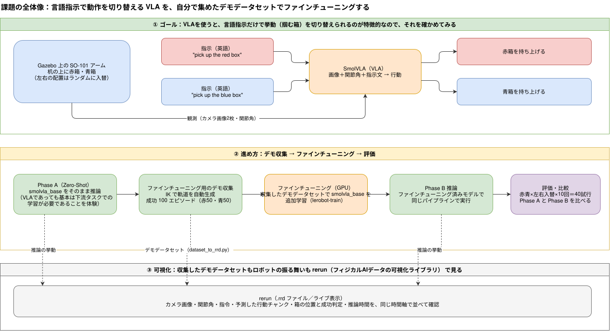
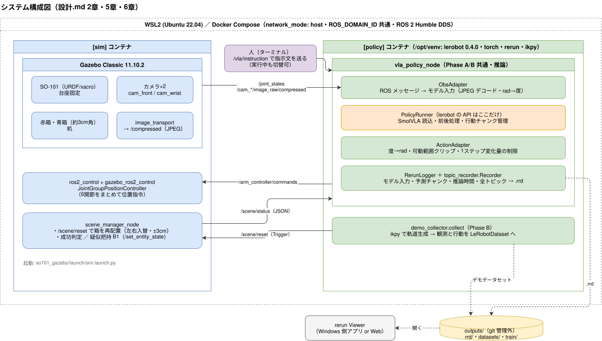
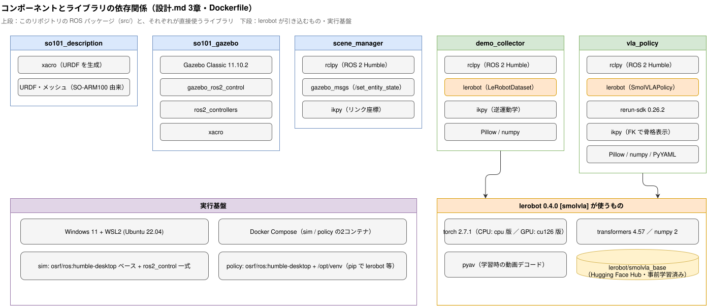
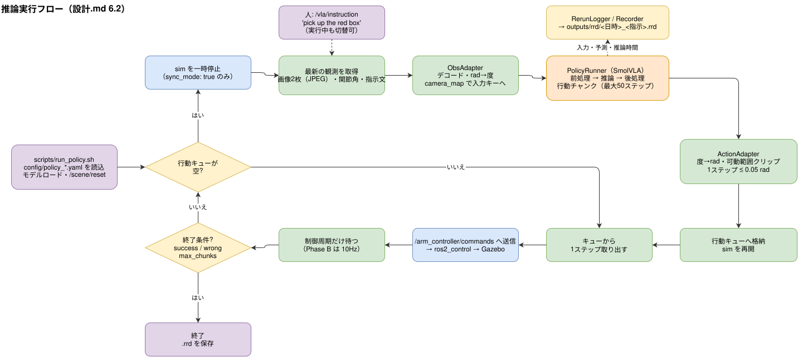
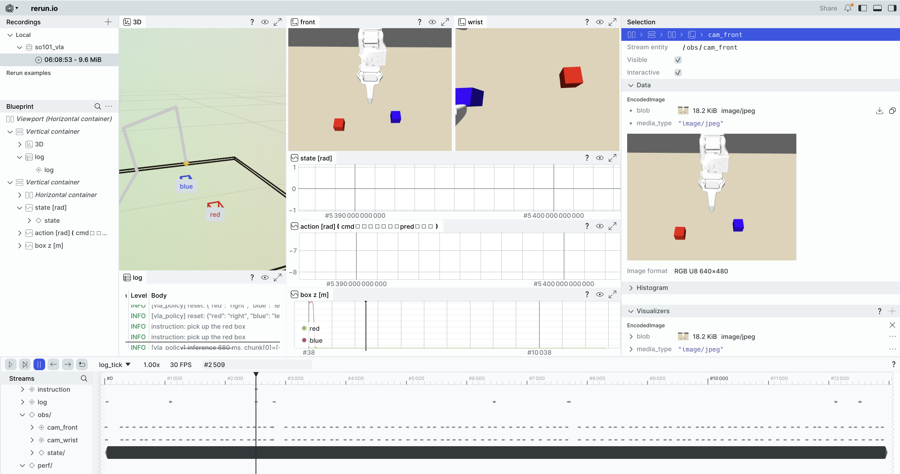
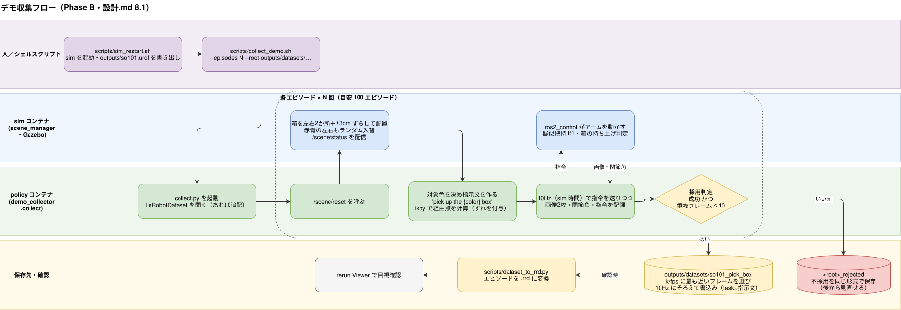
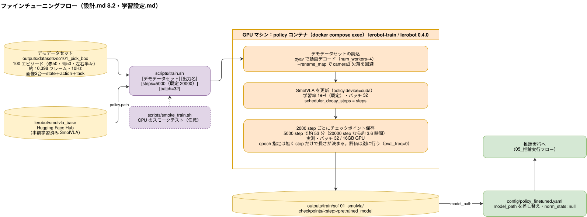

# 設計（現行版）

> このファイルは **「今こうなっている／こう作る」という確定した設計だけ** を書く。
> 設計を変えたら、このファイルを書き換え、末尾の「決定事項ログ」に1行追加する。

---

## 1. 目的とゴール

**Gazebo 上の SO-101 アームの前に赤・青2つの箱を置き、SmolVLA に英語で指示を出して、指示した色の箱を掴ませる。**

- 見せたいこと：**同じ方策・同じ配置でも、言語指示を変えるだけで掴む箱が切り替わる**（VLAの特徴）
- 進め方：
  - **Phase A**：`smolvla_base` をそのまま推論する（Zero-Shot 検証。動かなくても記録が成果になる）
  - **Phase B**：自動生成したデモで ファインチューニング → 同じパイプラインで推論し、A と比較する



### 成功の定義（Phase B）

| 評価 | 条件 | 目標 |
| --- | --- | --- |
| 把持成功率 | 指示した色の箱を持ち上げる（箱の z が閾値以上） | 各指示で 60% 以上 |
| 言語の効き | 赤・青の **左右を入れ替えた配置** でも、指示どおりの箱を選ぶ | 誤った箱を掴む率が A より明確に低い |

> 左右入れ替えで評価するのは、モデルが言語を無視して「いつも左の箱」のような位置のくせを覚えていないか確認するため。

---

## 2. 全体構成



（図の元データ：[図/01_システム構成.drawio](図/01_システム構成.drawio)）

- 通信：ROS 2 Humble（DDS）。全コンテナ `network_mode: host` / `ipc: host` / 同じ `ROS_DOMAIN_ID`
- policy コンテナの Python：`/opt/venv`（system-site-packages 有効）。apt 版から使うのは rclpy などの ROS パッケージだけで、それ以外の依存は `pip --ignore-installed` で venv に入れる。**cv_bridge は numpy 1 系向けのため使わない**（`sensor_msgs/Image` は `np.frombuffer` で変換する）
- Phase B では [policy] と同じイメージで `demo_collector`（自動デモ収集）を動かす。学習は GPU マシンで実行する

---

## 3. 技術スタック



| 要素 | 採用 | 備考 |
| --- | --- | --- |
| OS / 実行環境 | Windows 11 + WSL2 (Ubuntu 22.04) + Docker Compose | |
| ROS | ROS 2 Humble | 講義と同じ |
| シミュレータ | 講義イメージと同じ **Gazebo Classic 11.10.2** | gazebo_ros2_control・ros2_controllers・xacro は講義イメージに入っている。イメージ内の ROS apt 鍵は期限切れのため Dockerfile で更新する |
| ロボット | SO-101（TheRobotStudio/SO-ARM100 の URDF） | Apache-2.0。ライセンス表記ごと同梱する |
| 制御 | ros2_control + `JointGroupPositionController`（6関節まとめて位置指令） | グリッパも回転関節なので同じグループに入れる |
| VLA | LeRobot の SmolVLA（`lerobot/smolvla_base` → ファインチューニング 済みモデル） | **lerobot 0.4.0 に固定**（Python 3.10 を許容する系列。0.6 系は 3.12 必須）。torch 2.7.1（CPU 版。GPU マシンは cu126 版）・transformers 4.57・numpy 2 |
| 可視化 | rerun **0.26.2**（SDK と Viewer は同じバージョンに固定） | Phase A から導入。lerobot 0.4.0 の要求は >=0.24,<0.27 |
| IK（Phase B） | ikpy（URDF から逆運動学を解く） | 5自由度なので姿勢は近似で可 |
| 推論デバイス | CPU（普段のノートPC）／GPU（学習・本番評価用） | 設定ファイルで切替（`config/policy_base.yaml` / `config/policy_base_gpu.yaml`） |

---

## 4. ディレクトリ構成

リポジトリのルートを colcon ワークスペースとして使う（`src/` にパッケージを置く）。

```
practice-vla-robot-arm/
├─ README.md                  # 起動手順
├─ compose.yaml
├─ docker/
│  ├─ sim/Dockerfile          # 講義イメージ（ROS 2 + Gazebo）がベース
│  └─ policy/Dockerfile       # ROS 2 Humble + PyTorch(CPU/GPU) + lerobot + rerun
├─ config/
│  ├─ policy_base.yaml        # Phase A：smolvla_base 用
│  └─ policy_finetuned.yaml   # Phase B：ファインチューニング 済みモデル用
├─ src/
│  ├─ so101_description/      # URDF・メッシュ（外部から同梱）
│  ├─ so101_gazebo/           # world・launch・controllers.yaml・カメラ・箱
│  ├─ scene_manager/          # 箱の配置リセット・成功判定
│  ├─ vla_policy/             # 推論ノード（Phase A/B 共通）
│  └─ demo_collector/         # Phase B：自動デモ生成・LeRobot形式で保存
├─ scripts/                   # 学習・評価のラッパー
├─ outputs/                   # .rrd・評価結果・動画素材（git 管理外）
└─ docs/
   ├─ 図/                    # draw.io の図（.drawio）と書き出した .svg（図/README.md）
   └─ rrd/                   # 残しておく .rrd（Phase A の挙動など）。差し替えず、増やすだけにする
```

---

## 5. ROS インターフェース

| 名前 | 型 | 送信 → 受信 | 内容 |
| --- | --- | --- | --- |
| `/joint_states` | `sensor_msgs/JointState` | sim → policy | 6関節の角度 [rad] |
| `/cam_front/image_raw` | `sensor_msgs/Image` | sim → policy | 正面上方から机を見下ろすカメラ |
| `/cam_wrist/image_raw` | `sensor_msgs/Image` | sim → policy | 手首カメラ（SO-101 データセットの定番構成に合わせる） |
| `/cam_*/image_raw/compressed` | `sensor_msgs/CompressedImage` | sim → policy | 上の2つの JPEG 版（image_transport が出す）。**policy 側はこちらを購読する**（rclpy は生画像のデシリアライズが遅い） |
| `/arm_controller/commands` | `std_msgs/Float64MultiArray` | policy → sim | 6関節の目標角 [rad] |
| `/vla/instruction` | `std_msgs/String` | 人 → policy | 指示文。実行中でも切り替えられる |
| `/scene/reset` | `std_srvs/Trigger` | policy / collector → sim | アームを初期姿勢へ戻し、箱を再配置する |
| `/scene/status` | `std_msgs/String`(JSON) | sim → policy / collector | 箱の位置・色の配置・持ち上げ判定・掴んでいる箱（`layout, target, box_pos, lifted, grasped, success, wrong`） |

関節順は URDF に合わせて固定する：`shoulder_pan, shoulder_lift, elbow_flex, wrist_flex, wrist_roll, gripper`（URDF の名前で確認済み）。可動範囲 [rad]：pan ±1.92、lift ±1.75、elbow ±1.69、wrist_flex ±1.66、wrist_roll −2.74〜2.84、gripper −0.17〜1.75。

---

## 6. 推論ノード（vla_policy）の設計

### 6.1 クラス構成

| クラス | 役割 |
| --- | --- |
| `ObsAdapter` | ROS メッセージ → LeRobot の入力辞書へ変換。**単位変換**（rad ⇔ 学習データの単位）、画像のリサイズ・RGB化、カメラ名の対応付け |
| `PolicyRunner` | モデル読み込み、前処理・後処理、行動チャンクの管理。**lerobot の API に依存する部分はここに閉じ込める**（バージョンアップで API が変わっても直すのはここだけ） |
| `ActionAdapter` | モデル出力 → 関節目標角 [rad]。関節の可動範囲でクリップする |
| `RerunLogger` | 下記 6.3 のログ出力 |
| `VlaPolicyNode` | 上記をつなぐ ROS ノード。制御ループと指示文の購読 |

### 6.2 制御ループ（CPU でも破綻しない「同期モード」）

CPU では1回の推論に時間がかかる（**実測で、1チャンクあたり約 25〜35 秒**）。推論中にシミュレーションが進むと、観測と行動がずれて失敗の原因が分からなくなる。そのため次のループにする。



（図の元データ：[図/05_推論実行フロー.drawio](図/05_推論実行フロー.drawio)）

- `sync_mode: true/false` を設定で切り替える。GPU で十分速い場合は false（一時停止なし）にできる。false でも、チャンクを全部実行してから次を推論する逐次の流れは変わらない（推論中の約 0.3 秒は最後の指令を保持して止まり、sim 時間は進む）。推論と実行を重ねる非同期推論は、観測の古さの扱いが要るので実装しない
- `n_action_steps`（チャンクのうち実行する数）も設定で変えられるようにする。小さいほど反応は良いが推論回数が増える

### 6.3 rerun に出すログ（Phase A から）

記録は2つに分ける。トピックから取れるものは `topic_recorder.Recorder`（`src/vla_policy/vla_policy/topic_recorder.py`）が記録する。アームを動かしているのが誰でも（grasp_test.py・デモ収集・vla_policy）同じ形で残る。単体では `scripts/rrd_record.py` で動かす。推論に固有のものは `RerunLogger` が足す。vla_policy_node は両方を同じ .rrd に書く。

| エンティティ | 内容・元のトピック | 記録するもの |
| --- | --- | --- |
| `obs/cam_front`, `obs/cam_wrist` | `/cam_*/image_raw/compressed`（JPEG のまま記録。既定で最大 10Hz） | Recorder |
| `obs/state/<関節名>` | `/joint_states` [rad] | Recorder |
| `action/cmd/<関節名>` | `/arm_controller/commands`（実際に送った指令）[rad] | Recorder |
| `world/arm`, `world/gripper_tip` | `/joint_states` を ikpy で FK した骨格（`outputs/so101.urdf` を使う） | Recorder |
| `world/box/<色>`, `scene/box_z/<色>`, `scene/success`, `scene/wrong`, `scene/status` | `/scene/status` | Recorder |
| `instruction` | `/vla/instruction` | Recorder |
| `log` | `/rosout` のうち scene_manager・vla_policy のもの（`grasp check`・推論時間など） | Recorder |
| `policy/input/<入力キー>` | **モデルに実際に渡した画像** | RerunLogger |
| `policy/input/state/<関節名>` | モデルに渡した関節角（学習データの単位） | RerunLogger |
| `action/pred/<関節名>` | 予測したチャンク全体（rad に直したもの・クリップ前）。実行される予定の時刻に並べる | RerunLogger |
| `perf/inference_ms` | 推論時間 | RerunLogger |



- タイムラインは `sim_time` にする。stamp のあるメッセージ（画像・関節）は stamp を使い、stamp のないメッセージは直近に受け取った stamp を使う（`/clock` は 10Hz しか出ないため）
- vla_policy は毎回 `outputs/rrd/<日時>_<指示>.rrd` に保存する（あとでレポート・動画に使う）。ライブ表示は任意（`--live` を付けると Viewer のポート 9876 に送る）

### 6.4 設定ファイル（`config/policy_base.yaml`）

```yaml
model_path: lerobot/smolvla_base
device: cpu              # cpu / cuda
num_threads: null
sync_mode: true
control_hz: 30
n_action_steps: 50
max_chunks: 6            # 1エピソードの推論回数
stop_on_done: true       # success / wrong になったら終える
reset: true              # 始める前に /scene/reset する
instruction: "pick up the red box"
camera_map:              # ROS トピック → モデルの入力キー
  /cam_front/image_raw/compressed: observation.images.camera1
  /cam_wrist/image_raw/compressed: observation.images.camera2
image_size: null         # [幅, 高さ]。null ならそのまま
state_unit: degree       # 学習データ側の関節の単位（行動も同じ）
norm_stats: so100        # 正規化の統計の名前（下記）。ファインチューニング 済みモデルでは null
max_step: 0.05           # 1ステップあたりの関節の最大変化 [rad]
rerun:
  save_dir: outputs/rrd
  live: false
  urdf: outputs/so101.urdf
```

`smolvla_base` について 確認したこと：

- 入力は `observation.state`（6）と `observation.images.camera1〜3`。camera3 は渡さなくても推論できる。画像はモデル内で 512×512 にパディング付きで縮小されるので、こちらでは縮小しない。正面カメラを camera1、手首カメラを camera2 にする
- 正規化の統計は、データセット名の付いたキー（`so100.buffer.action`・`so100-red.…`・`so100-blue.…`）で保存されている。そのままでは `action` に当たらず、正規化されない（出力は正規化された空間の値のまま）。`PolicyRunner` で `norm_stats` の統計を `action` に当て直す。state の統計は保存されていないので、action の統計で代用する（SO-100 系は state と action が同じ関節空間）
- 単位は度（`so100` の action の平均は shoulder_lift で約 120°）。こちらの関節角（rad）を度にして渡す。SO-100 の較正のゼロ点と URDF のゼロ点の違いは補正していない（Phase A は「動くこと」の確認のため。Phase B は自分のデータで学習するので問題にならない）
- 予測の最初のステップは、現在の関節角に近い値になる（初期姿勢のまま渡すと、初期姿勢に近い値が返る）ので、単位と統計の当て方は合っているとみなした
- 画像は `/compressed`（JPEG）を購読して PIL でデコードする。rclpy は生画像のデシリアライズが遅いため
- lerobot は venv（/opt/venv）にあるので、ノードは `ros2 run` ではなく `python -m vla_policy.vla_policy_node` で起動する（`scripts/run_policy.sh`）

### 6.5 指示文は英語にする

SmolVLA の言語モデル部は英語で学習されているため、指示は英語で出す（`"pick up the red box"` / `"pick up the blue box"`）。動画・レポートには日本語訳を添える。

---

## 7. シミュレーション環境（sim）

- 机・SO-101（台座は固定）・赤箱・青箱（約 3cm 角）・カメラ2台
- `scene_manager`：
  - リセット時、箱を **左右2か所＋ランダムずれ（x・y 各 ±3cm）** に配置する。**赤青の左右もランダムに入れ替える**
  - 成功判定：指示色の箱の z が初期値 + 5cm 以上 → 成功。逆の色が持ち上がったら「誤った箱」
- 把持の安定化：**疑似固定（B1）を使う**（摩擦だけの把持は試して断念。経緯は決定事項ログを参照）
  - 開いていたグリッパが閉じた瞬間（角度 0.4 より開く → 0.25 より閉じる）に、箱の中心が指の間の範囲内（gripper_link 座標）なら掴んだとみなし、scene_manager が `/set_entity_state` で箱を手先に追従させる（掴んだ瞬間の相対位置を保つ）。0.4 より開いたら離す。しきい値と範囲は scene_manager のパラメータ（値は scripts/grasp_test.py で確認した）
  - 可動指は箱と当たらないようにする（`collide_bitmask`：可動指 0x01、箱 0x02）。固定指と手のひらは当たる
  - `/model_states`・`/link_states` は 50Hz（追従の遅れを減らす）
  - **CPU ではカメラが壁時計で約 2 枚/秒しか描画できない**（解像度を 256×192 に下げても変わらなかった）。sim 時間あたりの枚数を増やすため、`real_time_update_rate` を 80（リアルタイムの約 0.16 倍）にして sim を遅くしている。GPU マシンでは 30 枚/秒出るので、`compose.gpu.yaml` で 500（RTF 1）に上書きする（環境変数 `SIM_REAL_TIME_UPDATE_RATE`）。Phase B のデータセットの fps・制御周期は **10Hz**（sim 時間）。1エピソード 10 秒の sim は壁時計で約 60 秒かかる。Phase A の 30Hz 制御は、画像が古いまま動くことになる。理由と GPU 環境での変更手順は [sim速度設定.md](sim速度設定.md)
  - 判定は甘くしない。レポートに明記する
  - B1 の試行の上限（sim の再起動 5 回・把持テスト 15 回）を超えてもだめなら、タスクを「タッチ」（指先が指示した色の箱に一定距離まで近づいたら成功）に変える

---

## 8. Phase B：デモ収集と ファインチューニング

### 8.1 自動デモ生成（demo_collector）



（図の元データ：[図/03_デモ収集フロー.drawio](図/03_デモ収集フロー.drawio)）

- 目安：100 エピソード（赤50・青50、左右の入れ替えも半々）
- 収集したデータの目視確認：`scripts/dataset_to_rrd.py` でエピソードを .rrd に変換して rerun で見る（使い方は README の「デモを収集する」）
- 講義の rosbag → LeRobot 変換は使わず、**`LeRobotDataset` に直接書き込む**（手順が1つ減る）
- 動きが毎回同じにならないよう、経由点や速度に少しランダムなずれを入れる

### 8.2 学習



- GPU マシンで `lerobot` の学習コマンドを実行（`smolvla_base` から開始）。手順は `scripts/` にまとめる
- 学習済みモデルを `outputs/` か Hugging Face Hub（非公開）に置き、`config/policy_finetuned.yaml` の `model_path` を書き換えるだけで推論できるようにする

### 8.3 評価

- Phase B：チェックポイント（2000・4000・5000 ステップ）ごとに、同じ seed の配置で赤・青の指示を交互に 10 試行し、成功・失敗の数を表にする（結果は [実験結果.md](実験結果.md)）
- Phase A（base）：成功率の評価はしない。赤・青の各 1 エピソードを .rrd に記録し、動画で B と並べる（`docs/rrd/phase_a_gpu_*.rrd`）

---

## 9. CPU で動かすときの方針

- ノートPC（CPU のみ）：開発・動作確認と Phase A 推論。同期モードで動かす
- GPU マシン：ファインチューニング、評価の本番、動画撮影
- 両方で同じ `compose.yaml` を使う。GPU の設定は `compose.gpu.yaml` に分け、GPU マシンでだけ重ねて起動する（`docker compose -f compose.yaml -f compose.gpu.yaml up`）。sim の描画も GPU にし、sim を実時間（RTF 1）で動かす。CPU と GPU の設定値の一覧は [sim速度設定.md](sim速度設定.md) 0 章
- CPU の負荷を下げるため、カメラ解像度は小さめ（例 640×480 以下）、Gazebo の GUI は必要なとき以外は止める（ヘッドレス起動を用意する）

---

## 10. 未確定事項（確認したらこの表から消して本文に反映）

| 項目 | 確認するタイミング |
| --- | --- |

---

## 11. 決定事項ログ

| 日付 | 決定 | 理由 |
| --- | --- | --- |
| 2026-10-16 | 案B（fine-tune）を本命、案A（Zero-Shot）から着手 | 推論パイプラインは共通で、A を作れば B はモデルの差し替え＋デモ収集で済む |
| 2026-10-16 | タスクは「赤・青の箱を言語指示で選んで掴む」 | VLA の特徴（言語で動作切替）を最も分かりやすく見せられる |
| 2026-10-16 | 案C（専用モデルの組み合わせ）は採用しない | VLA を学ぶことが目的のため |
| 2026-10-16 | ロボットは SO-101 | SmolVLA の事前学習データと同じ構成 |
| 2026-10-16 | 推論は CPU 前提、同期モードを用意 | 普段の作業 PC が CPU のみのため |
| 2026-10-16 | rerun は Phase A から導入 | 入力画像・単位・予測値のずれを早く見つけるため |
| 2026-10-16 | 仕様管理は md ファイル（OpenSpec 等は使わない） | 1人・約2.5週間の開発で、ツールの学習コストに見合わないため |
| 2026-10-16 | lerobot は 0.4.0 に固定、Python は 3.10 のまま | lerobot 0.6 系は Python>=3.12 必須だが、Humble の rclpy は 3.10 専用。0.4.0 は 3.10 を許容する |
| 2026-10-16 | シミュレータは Gazebo Classic 11.10.2（講義イメージのまま） | 確認済み。ros2_control 関連も講義イメージに入っている |
| 2026-10-16 | rerun-sdk は 0.26.2 に固定 | lerobot 0.4.0 が >=0.24,<0.27 を要求するため（当初予定の 0.22 は入らない） |
| 2026-10-16 | policy の venv は依存を `--ignore-installed` で入れ、cv_bridge は使わない | apt 版の古い Pillow・scipy が混ざって import に失敗した。rerun 0.24 以降が numpy 2 必須で、apt 版 cv_bridge は numpy 1 系向け |
| 2026-10-16 | SO-101 の URDF は TheRobotStudio/SO-ARM100 の `so101_new_calib.urdf` を xacro 化して同梱。台座は `world` リンクに固定し、衝突形状は台座・グリッパ・可動指だけ残す | 台座を固定しないとアームが倒れる。他リンクの衝突形状は把持に関係せず ODE が重くなるため |
| 2026-10-16 | Gazebo へ渡す URDF は launch 内でコメント除去・空白圧縮し、`package://` を `file://` に置換する | gazebo_ros2_control が URDF を ROS 引数として再パースするため、コメント・長さで失敗する。Gazebo Classic は `package://` のメッシュを描画しない |
| 2026-10-16 | 摩擦による物理的な把持（案A）は打ち切り、疑似固定（B1）にする。B1 もだめならタスクを「タッチ」に変える | Gazebo Classic と gazebo_ros2_control 0.4.10 の接触計算・PID の不具合が重なり、複数の仮説を試しても挟めなかった |
| 2026-10-24 | B1 は「開いた状態から閉じた瞬間」に1回だけ判定する。可動指は元のメッシュに戻して箱とだけ当たらないようにする | 閉じたまま近づいただけで掴めないようにするため（判定を甘くしない）。B1 は再起動 1 回・テスト 5 回で左右とも成功し、タッチ課題への変更は不要になった |
| 2026-10-24 | rerun の記録を、トピックを購読する `scripts/rrd_record.py` と vla_policy の `RerunLogger` に分ける。画像は `/compressed` を記録する | 把持やデモ収集のように、モデルを通さない動作もシーンとして確認するため。rclpy は生画像のデシリアライズが遅く、他のトピックを取りこぼすため |
| 2026-10-24 | smolvla_base の入力は正面カメラ → camera1・手首カメラ → camera2、単位は度。正規化は `so100` の action の統計を当て直し、state にも使う | 保存されている統計のキーにデータセット名が付いていて、そのままでは正規化されないため（6.4） |
| 2026-10-24 | vla_policy の画像入力は `/cam_*/image_raw/compressed`。ノードは venv の python で `python -m` 起動する | rclpy は生画像のデシリアライズが遅い。`ros2 run` は /usr/bin/python3 で起動し、venv の lerobot が見えないため |
| 2026-10-24 | ActionAdapter は、可動範囲でクリップしたうえで、1ステップの変化量を 0.05 rad に制限する | 位置指令は関節を直接その角度へ動かすので、予測が飛んだときにアームが瞬間移動して箱を弾き飛ばさないようにする |
| 2026-10-24 | 箱のランダムずれ（`jitter`）を ±1cm から ±3cm（x・y 独立の一様乱数）に広げる | 箱が3cm角で ±1cm ではばらつきが小さく、fine-tune 後に位置を暗記しやすいため。デモ収集の前に IK で全範囲に届くことを確認する |
| 2026-10-24 | Phase B のデータセットの fps・制御周期を 10Hz（sim 時間）にし、world の `real_time_update_rate` を 500 → 80 にする | カメラが壁時計で約 2 枚/秒しか描画できず（RTF 0.87 のとき sim 時間で 2.1Hz、RTF 0.2 のとき 8.5Hz と実測）、解像度を下げても改善しない。sim を遅くすれば、全フレームが新しい画像になる。30Hz にするには RTF 約 0.06 が要り、100 件で約 4 時間かかる |
| 2026-10-24 | デモ収集は `src/demo_collector`（`python -m demo_collector.collect`）。画像が届いた sim 時刻で指令を決め、エピソード後に k/fps に最も近いフレームを選んで 10Hz にそろえて書く。学習の特徴量不一致は `--rename_map` で回避する | 画像の間隔が 0.08〜0.25 秒でそろわない。smolvla_base は camera3 を要求するが、本データは 2 台のため |
| 2026-10-24 | デモ収集で、重複フレームが 10 を超えたエピソード・成功判定に通らなかったエピソードは採用せず、`<root>_rejected` に同じ形式で残す | 10 件の確認で 2 件が重複 24〜29 フレーム（画像の途切れ）だった。止まって見える区間を学習に使わない一方、後から見直せるように捨てない |
| 2026-10-24 | Phase A の再評価・.rrd の撮り直しは評価時に行う（新しい sim 設定、制御 10Hz。旧 `phase_a_cpu_*.rrd` は残す） | 最初の記録は旧設定（RTF 0.87）のため。A と B を同じ条件で比べないと fine-tune の効果を切り分けられない。評価で 40 試行を回す時に一緒に撮れる |
| 2026-10-24 | GPU マシンでは sim の描画も GPU（WSL2 の `/dev/dxg` + Mesa d3d12）にし、`real_time_update_rate` を 500（RTF 1）に上書きする。policy の torch は cu126 版にする。fps 10 は変えない | GPU ではカメラ 2 台が RTF 1 でも 30 枚/秒出ると実測した（CPU は約 2 枚/秒）。sim を遅くする理由がない。cu121 には torch 2.7.1 が無い。fps を変えると CPU で集めたデータと混ぜられない |
| 2026-10-24 | 評価は GPU マシン（RTF 1）で行う。推論ノードの制御周期を sim 時間で刻む改修は、CPU で評価する場合だけ行う | 推論ノードは制御周期を壁時計で刻んでおり、sim 時間での周期は `control_hz ÷ RTF` になる。GPU（RTF 1.00 で安定）では設定どおりだが、CPU（RTF 0.16）では約 6 倍速くなる。sim 時間で刻むには `/clock`（今は 10Hz）を速く出す設定も要り、締切までの手間に見合わない |
| 2026-10-24 | GPU 用設定（`policy_base_gpu.yaml`）は `sync_mode: false`。非同期推論（推論と実行の重ね合わせ）は実装しない | GPU では推論が約 0.3 秒でチャンク（約 1.7 秒）より短く、止めなくてもずれは小さい。課題では厳密性を求めず、観測の古さを扱う非同期は割愛する |
| 2026-10-24 | 評価（8.3）の 40 試行（赤・青 × 左右 × 各 10）と Phase A / B の比較表は取りやめ、B のチェックポイント比較（各 10 試行）と Phase A の 1 エピソード記録にする | fine-tune 前の base はほぼ確実に掴めず比較の情報が増えないため。厳密な数値は求められていないため |
